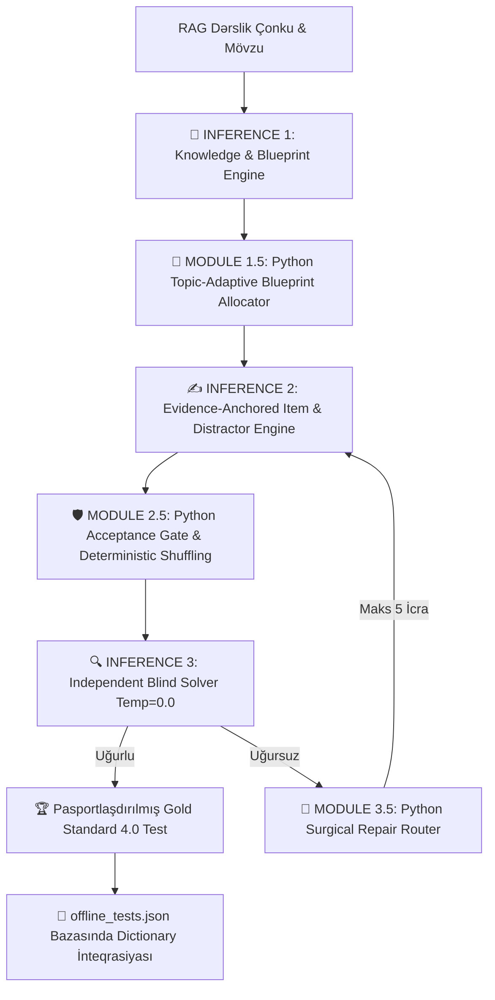

# 📑 11-ci Sinif Test Generasiyası İcra Planı: Gold Standard 4.0 (AI Test OS) Arxitekturası ilə

Bu sənəd 11-ci sinif dərsliklərinin RAG çonkları əsasında **Gold Standard 4.0: Architecture Specification (AI Test OS)** standartlarına 100% uyğun olaraq test generasiyasının, pasportlaşdırmanın və sistemə inteqrasiyanın tam icra planıdır.

---

## 1. Gold Standard 4.0: Architecture Specification (AI Test OS)

### 📌 Qızıl Qaydalar (Golden Rules)
1. **⚙️ QIZIL QAYDA #1:** *"If Python can calculate it, LLM must NEVER generate it."* (Əgər Python bir şeyi hesablaya bilirsə, LLM onu heç vaxt generasiya etməməlidir.)
2. **⚡ QIZIL QAYDA #2 (Inference Economy):** *"The architecture minimizes API pressure by reducing the normal execution path to 3 Primary LLM Inferences (Maximum 5 Inferences including Auto-Repair loops). Deterministic indexing eliminates index-mapping errors, while an Independent Solver validates semantic correctness."*

---

## 2. Sistem Topologiyası və İcra Boru Kəməri (Pipeline)



### ⚙️ 3 Əsas LLM İcrası və Python Dəstək Boru Kəməri:
1. **🧠 INFERENCE 1: Knowledge, Concept & Blueprint Engine (LLM)**
   * Konsept $\rightarrow$ Bilik vahidi (Knowledge Unit) $\rightarrow$ Sual niyyəti (Question Intent) xəritələndirilməsi.
2. **🐍 MODULE 1.5: Python Topic-Adaptive Blueprint Allocator (Saf Python Kodu)**
   * Mövzu çəkisinə görə hər mövzuya minimum $\ge 15$ test paylanması.
   * Mövzu-adaptiv Blum siyasəti (Mətnlər üçün 70% Anlama, analitik mövzular üçün balanslaşdırılmış Tətbiq/Təhlil).
3. **✍️ INFERENCE 2: Evidence-Anchored Item & Distractor Engine (LLM)**
   * Sual kötüyü (question_stem), doğru cavab (correct_option_text), dərslikdən birbaşa sitat sübutları (`text_excerpts`), 3 konseptual yayındırıcı (`distractors`) və elmi izah (`why_correct`).
   * Çıxış: İndekssiz xam JSON (LLM indeks hesablamır).
4. **🛡️ MODULE 2.5: Python Acceptance Gate & Deterministic Shuffling (Saf Python Kodu)**
   * **Boş / Qüsurlu JSON yoxlanışı:** Python səviyyəsində təkrar sorğu.
   * **Təkrarlanan suallar:** Python ilə rədd edilir.
   * **Deterministik İndeksləmə:** Variantlar array-də birləşdirilir, `random.shuffle()` edilir və riyazi olaraq dəqiq tam ədəd `correctAnswer` (0=A, 1=B, 2=C, 3=D) təyin olunur.
5. **🔍 INFERENCE 3: Independent Blind Solver (Müstəqil LLM / Temp=0.0)**
   * Təcrid olunmuş model sualı kor-koranə həll edir. Əgər `Solver_Index != Deterministic_Index` olarsa, Cərrahi Təmir (Surgical Repair) işə düşür.
6. **🐍 MODULE 3.5: Python Surgical Repair Router (Saf Python)**
   * Yayındırıcı qeyri-müəyyənliyi $\rightarrow$ Yalnız yayındırıcılar yenidən qurulur (75% token qənaəti).
   * Çatışmayan sübut $\rightarrow$ Yalnız sitat yenilənir (80% token qənaəti).
   * Semantik uyğunsuzluq $\rightarrow$ Tam bərpa (Maksimum 5 ümumi icra limiti ilə).

---

## 3. Struktur, İzah və Pasportlaşdırma Standartları

### 🎯 Kritik Struktur Qaydaları:
* **`options` Formatı:** Variantlar qətiyyən Obyekt (`{"A": "..."}`) OLMAMALIDIR! Mütləq şəkildə Siyahı (Array) `["...", "...", "...", "..."]` formatında olmalıdır.
* **`correctAnswer` İndeksi:** Doğru cavab hərflə ("A", "B") deyil, Array-dəki indeksə uyğun **Integer (0, 1, 2, 3)** olmalıdır. İndekslər bərabər ($A=25\%, B=25\%, C=25\%, D=25\%$) paylanmalıdır.
* **Dinamik Pedaqoji İzah:** İzah daxilində heç vaxt "A variantı doğrudur, çünki..." kimi sabit hərflər yazılmamalıdır. İzah birbaşa dərslik faktı və elmi arqumentlə başlamalıdır.

### 📜 Qızıl Standart 4.0 Sual Formatı:
```json
{
  "question": "Sualın mətni...",
  "options": ["A variantının mətni", "B variantının mətni", "C variantının mətni", "D variantının mətni"],
  "correctAnswer": 2,
  "bloom_level": "Tətbiq",
  "difficulty": "Orta",
  "measured_skill": "Məzmun standartı və ya bacarıq adı",
  "explanation": {
    "correct": "Dərslikdəki mətnə əsaslanan orijinal elmi izahat...",
    "distractors": {
      "0": "Yayındırıcının yanlışlıq səbəbi...",
      "1": "Yayındırıcının yanlışlıq səbəbi...",
      "3": "Yayındırıcının yanlışlıq səbəbi..."
    }
  },
  "distractor_diagnostics": {
    "0": "conceptual_error",
    "1": "typical_mistake",
    "3": "term_confusion"
  },
  "solution_steps": ["Addım 1", "Addım 2"],
  "topic": "Dərslikdəki Mövzu Adı",
  "cat": "Fənnin və Sinfın Adı",
  "passport_id": "11-010-0213-13R03-03-02-005"
}
```

### 🆔 Vahid 7-Hissəli Test Pasportu Formatı:
$$\mathbf{[SS]-[FFF]-[BBMM]-[STK]-[BL]-[ÇÇ]-[NNN]}$$

1. **`[SS]` (Sinif):** 2 rəqəmli sinif kodu (məsələn: `11`).
2. **`[FFF]` (Fənn Kodu):** 3 rəqəmli fənn kodu:
   * `001` = Azərbaycan dili
   * `002` = İnformatika
   * `003` = Ümumi tarix
   * `004` = Coğrafiya
   * `005` = Ədəbiyyat
   * `006` = İngilis dili
   * `007` = Fizika
   * `008` = Kimya
   * `009` = Biologiya
   * `010` = Riyaziyyat
   * `011` = Azərbaycan tarixi
3. **`[BBMM]` (Bölmə və Mövzu):** 2 rəqəm Bölmə + 2 rəqəm Mövzu (məsələn: Bölmə 02, Mövzu 05 $\rightarrow$ `0205`).
4. **`[STK]` (Bacarıq/Standart Kodu):** Məzmun xətti və alt-standart kodu (məsələn: `13R03`, `01F01`).
5. **`[BL]` (Blum Səviyyəsi):** `01`=Bilik, `02`=Anlama, `03`=Tətbiq, `04`=Təhlil, `05`=Qiymətləndirmə, `06`=Yaratma.
6. **`[ÇÇ]` (Çətinlik):** `01`=Sadə, `02`=Orta, `03`=Çətin.
7. **`[NNN]` (Unikal Sıra Nömrəsi):** 3 rəqəmli unikal sıra nömrəsi (`001` - `999`).

*Nümunə Pasport ID:* `11-010-0205-13R03-03-02-015`

---

## 4. 11-ci Sinif Üzrə İcra Həcmi və Mərhələli Yol Xəritəsi

Sistemə inteqrasiya edilmiş [`curriculum_grade_11.json`](file:///C:/Users/User/Downloads/azerbaijanaiplatform/data/curriculum_grade_11.json) və [`grade_11_generation_queue.json`](file:///C:/Users/User/Downloads/azerbaijanaiplatform/data/grade_11_generation_queue.json) reyestrləri üzrə icra planı:

| Mərhələ | Fənlər | Mövzu Sayı | Hədəf Sual Sayı ($\ge 15$/mövzu) |
| :--- | :--- | :---: | :---: |
| 🚀 **Mərhələ 1: Dəqiq və Təbiət Elmləri** | **Riyaziyyat 11** *(27 mövzu)*<br>**Kimya 11** *(28 mövzu)*<br>**Fizika 11** *(26 mövzu)* | **81 Mövzu** | **~1 215 Sual** |
| 🏛️ **Mərhələ 2: Tarix Bloku** | **Azərbaycan tarixi 11** *(33 mövzu)*<br>**Ümumi tarix 11** *(24 mövzu)* | **57 Mövzu** | **~855 Sual** |
| 📚 **Mərhələ 3: Ana Dili və Ədəbiyyat** | **Azərbaycan dili 11** *(21 mövzu)*<br>**Ədəbiyyat 11** *(16 mövzu)* | **37 Mövzu** | **~555 Sual** |
| **CƏMİ** | **7 Əsas Fənn** | **175 Mövzu** | **~2 625 Sual** |

---

## 5. Doğrulama və Təhvil Metodologiyası

1. **Deterministik Validasiya:** Hər bir test Gold Standard 4.0 JSON schema və Pasport qaydalarına görə Python tərəfindən yoxlanacaq.
2. **`offline_tests.json` İnteqrasiyası:** Bütün testlər mövzu açarlı lüğət formatında bazaya əlavə olunacaq.
3. **Masaüstü və Layihə Sənədləşməsi:** Hər mərhələnin sonunda həm JSON bazası yenilənəcək, həm də oxunaqlı Markdown test bankları Masaüstünə və layihə kökünə çıxarılacaq.
