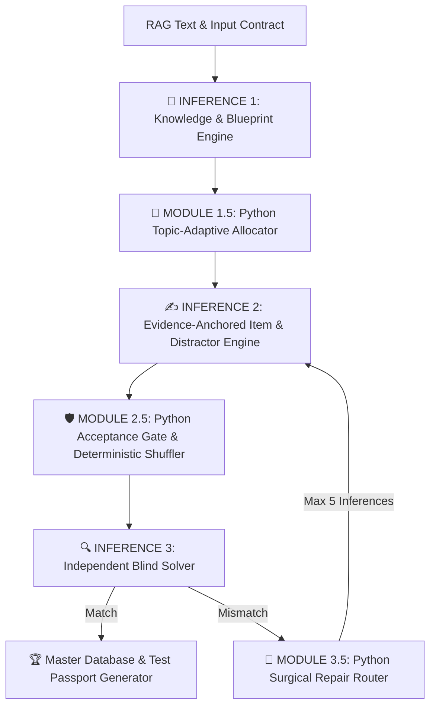

# 🎯 Gold Standard 4.0: Architecture Specification (AI Test OS)
## Memarlıq Spesifikasiyası (AI Test OS)

> **Versiya:** 4.0 (Production-Ready Multi-Agent AI Test OS)  
> **Əhatə:** 1-11-ci Siniflər (Universal)  
> **Məqsəd:** 100% RAG Dərslik Əsaslılıq, 0% Hallusinasiya, Minimum Token Xərci və Yüksək İcra Sabitliyi.

---

## 📌 1. Qızıl Qaydalar (Golden Rules)

### ⚙️ QIZIL QAYDA #1 (Python Hesablama Qanunu)
> **"If Python can calculate it, LLM must NEVER generate it."**  
> *(Əgər Python bir şeyi hesablaya bilirsə, LLM onu heç vaxt generasiya etməməlidir.)*
- Variantların qarışdırılması (`random.shuffle`), `correctAnswer` indeksinin riyazi hesablanması, cavab açarlarının balansı (25.0%), dublikat yoxlanışı və `passport_id` generasiyası birbaşa deterministik Python kodu ilə icra olunur.

### ⚡ QIZIL QAYDA #2 (İnference Qənaəti və Təhlükəsizlik)
> **"The architecture minimizes API pressure by reducing the normal execution path to 3 Primary LLM Inferences (Maximum 5 Inferences including Auto-Repair loops). Deterministic indexing eliminates index-mapping errors, while an Independent Solver validates semantic correctness."**
- **Normal Yol:** Dəqiq 3 Əsas LLM İnference-i.
- **Bərpa Yolu:** Cərrahi təmir ilə maksimum 5 İnference (Distraktor xətası olduqda yalnız distraktorlar yenilənir — 75% token qənaəti; Sübut çatışmadıqda yalnız sitatlar yenilənir — 80% qənaət).
- **Müstəqil Həlledici (Blind Solver):** Generatordan təcrid olunmuş model sualı kor-koranə həll edir və semantik doğruluğu təsdiqləyir.

---

## 📡 2. Giriş və Çıxış Sistem Müqavilələri (Contracts)

### 📥 1. Sistem Giriş Müqaviləsi (`SystemInputContract`)
```json
{
  "$schema": "http://json-schema.org/draft-07/schema#",
  "title": "SystemInputContract",
  "type": "object",
  "properties": {
    "topic": { "type": "string" },
    "category": { "type": "string" },
    "rag_text": { "type": "string" },
    "requested_count": { "type": "integer", "minimum": 1, "default": 21 },
    "difficulty_bias": { "type": "string", "enum": ["standard", "hard_focus", "easy_focus"] },
    "bloom_policy": { "type": "string", "enum": ["topic_adaptive", "balanced", "recall_heavy"] },
    "language": { "type": "string", "default": "az" }
  },
  "required": ["topic", "category", "rag_text", "requested_count"]
}
```

### 📤 2. Mərhələ 2 Çıxış Müqaviləsi (`Phase2OutputContract` - Un-indexed JSON)
```json
{
  "$schema": "http://json-schema.org/draft-07/schema#",
  "title": "Phase2OutputContract",
  "type": "object",
  "properties": {
    "item_id": { "type": "string" },
    "concept": { "type": "string" },
    "knowledge_unit": { "type": "string" },
    "question_intent": { "type": "string" },
    "bloom_level": { "type": "string", "enum": ["bilmə", "anlama", "tətbiq", "təhlil"] },
    "difficulty": { "type": "string", "enum": ["sadə", "orta", "çətin"] },
    "question_stem": { "type": "string" },
    "correct_option_text": { "type": "string" },
    "evidence": {
      "type": "object",
      "properties": {
        "text_excerpts": { 
          "type": "array", 
          "items": { "type": "string" },
          "description": "One or more verbatim text excerpts from RAG supporting the answer." 
        }
      },
      "required": ["text_excerpts"]
    },
    "distractors": {
      "type": "array",
      "items": { "type": "string" },
      "minItems": 3,
      "maxItems": 3
    },
    "explanation": {
      "type": "object",
      "properties": {
        "why_correct": { "type": "string" }
      },
      "required": ["why_correct"]
    }
  },
  "required": [
    "question_stem",
    "correct_option_text",
    "evidence",
    "distractors",
    "explanation"
  ]
}
```

---

## 🏛️ 3. 3 Əsas İnference və Python Dəstək Boru Kəməri



---

## 📋 4. Yekun Master JSON Strukturu və Qaydalar

```json
{
  "question": "Sualın mətni...",
  "options": ["A variantının mətni", "B variantının mətni", "C variantının mətni", "D variantının mətni"],
  "correctAnswer": 2,
  "bloom_level": "Tətbiq",
  "difficulty": "Orta",
  "measured_skill": "Məzmun standartı və ya bacarıq adı",
  "explanation": {
    "correct": "Dərslikdəki mətnə əsaslanan orijinal izahat...",
    "distractors": {
      "0": "Səbəbi...",
      "1": "Səbəbi...",
      "3": "Səbəbi..."
    }
  },
  "distractor_diagnostics": {
    "0": "conceptual_error",
    "1": "typical_mistake",
    "3": "term_confusion"
  },
  "solution_steps": ["Addım 1", "Addım 2"],
  "topic": "Dərslikdəki Mövzu Adı",
  "cat": "Fənnin və Sinfın Adı",
  "passport_id": "04-010-0102-01M02-03-02-005"
}
```

### ❗ Kritik Qaydalar:
1. **`options` Formatı:** Mütləq Siyahı (Array) `["...", "...", "...", "..."]` formatında olmalıdır. Obyekt (Dictionary) qadağandır!
2. **`correctAnswer` İndeksi:** Doğru cavab hərflə deyil, Integer (0, 1, 2, 3) kimi saxlanılır.
3. **Pedaqoji İzahda Dinamiklik:** Variantlar qarışdırıldığı üçün izahda "A variantı doğrudur" kimi hərflər YAZILMIR. İzah birbaşa dərslikdəki mətn və elmi əsaslandırma ilə başlayır.

---

## 🪪 5. TESTİN PASPORTU (Vahid Universal Standart)

Hər bir testin sistemdə 7-hissəli unikal "Şəxsiyyət vəsiqəsi" (Pasportu) olmalıdır:

$$\mathbf{[SS]-[FFF]-[BBMM]-[STK]-[BL]-[ÇÇ]-[NNN]}$$

- **`[SS]` (Sinif Kodu):** 2 rəqəmli (məs: `04`, `09`, `11`).
- **`[FFF]` (Fənn Kodu):** 3 rəqəmli (`001` = Azərbaycan dili, `002` = İnformatika, `003` = Ümumi tarix, `004` = Coğrafiya, `005` = Ədəbiyyat, `006` = İngilis dili, `007` = Fizika, `008` = Kimya, `009` = Biologiya, `010` = Riyaziyyat, `018` = Zəfər tarixi).
- **`[BBMM]` (Bölmə və Mövzu):** 2 rəqəm Bölmə + 2 rəqəm Mövzu (məs: Bölmə 02, Mövzu 13 $\rightarrow$ `0213`).
- **`[STK]` (Bacarıq/Standart Kodu):** Məzmun standartı və ya bacarıq identifikatoru (məs: `01A01`, `02M03`, `13R02`).
- **`[BL]` (Blum Səviyyəsi):** 2 rəqəmli idrak kodu (`01` = Bilik, `02` = Anlama, `03` = Tətbiq, `04` = Təhlil, `05` = Qiymətləndirmə, `06` = Yaratma).
- **`[ÇÇ]` (Çətinlik Kodu):** 2 rəqəmli çətinlik (`01` = Sadə, `02` = Orta, `03` = Çətin).
- **`[NNN]` (Unikal Sıra Nömrəsi):** 3 rəqəmli test nömrəsi (`001` - `999`).

**Nümunə Pasport ID:** `04-010-0204-02M01-03-02-015`
